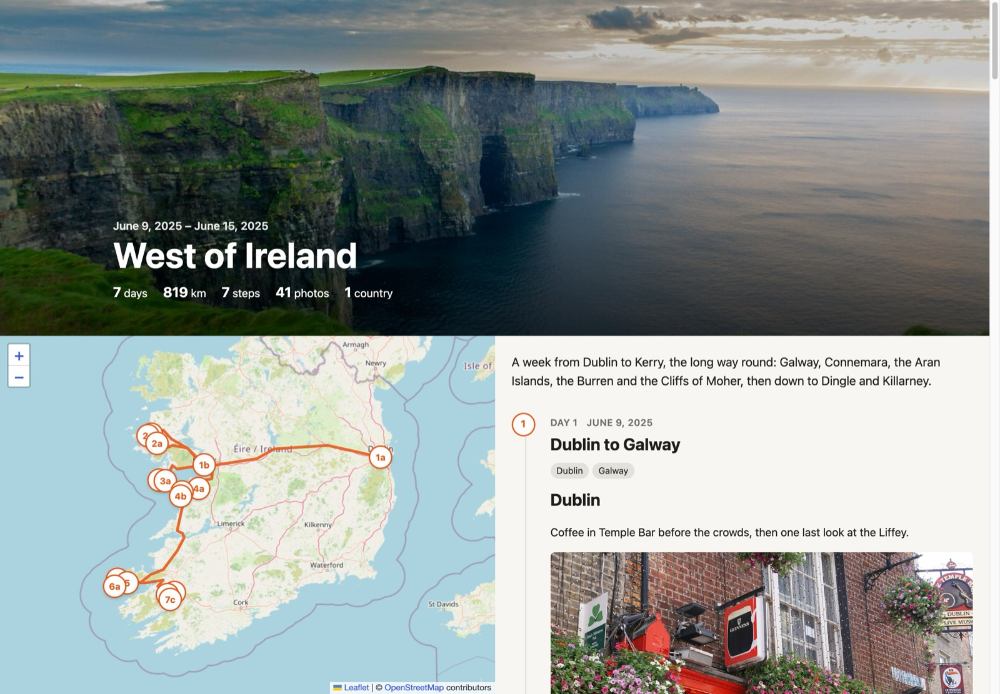

# Travel Steps

A travel journal for your own WordPress site, built with [WpApp](https://github.com/akirk/wp-app). Each day of a trip is a step, a post you write in the block editor. The route comes from your [Dawarich](https://dawarich.app) location history, or from where your photos were taken. Photos come from [Immich](https://immich.app), or you upload them to the trip.

Visitors never reach Immich. WordPress fetches the photos and serves them itself, so Immich and the original files stay private.

## Demo

[Try it in WordPress Playground](https://playground.wordpress.net/?blueprint-url=https://raw.githubusercontent.com/donnchawp/travel-steps/master/demo/blueprint.json). It's a week in the west of Ireland, running in your browser with nothing to install. Stand-in Immich and Dawarich servers send the photos and the route to the real sync code. You're logged in as an admin, so you can pin, hide and choose photos, edit the days in the block editor, and sync again.

[](https://playground.wordpress.net/?blueprint-url=https://raw.githubusercontent.com/donnchawp/travel-steps/master/demo/blueprint.json)

<sub>The demo photos are from [Unsplash](https://unsplash.com), and each one is credited in its caption. The screenshot shows the Cliffs of Moher by [Jarek Skowron](https://unsplash.com/photos/Zf9bvJ6182k) and Temple Bar by [Sarah](https://unsplash.com/photos/-ABmxr3Yo4Y). Map © [OpenStreetMap](https://www.openstreetmap.org/copyright) contributors.</sub>

## How it works

A trip is a `ts_trip` post with a date range. Its photos come from Immich (everything taken in those dates, or one album) or are uploaded to it. A step is a `ts_step` post, a child of the trip, and holds one day.

Sync works like this:

1. If Dawarich is set up, it fetches your points for those dates. It drops the points near home, and GPS glitches, which are points you'd have had to travel faster than 1,080 km/h to reach.
2. It fetches the album's photos, or all photos taken during those dates if there's no album. A photo without GPS gets the position you were at when you took it. Immich only names a place from a photo's own GPS, so any photo with a position but no town or country gets a town named offline, from the GeoNames data the plugin ships. A camera that records no time zone gets the offset of the nearest phone photo that does (or the site's), so its photos from abroad aren't hours off. Photos are kept by the local date they were taken, so the first morning and last evening of a trip in another time zone aren't cut off.
3. It creates a draft step for each day with favourites. The day is the local date the photos were taken (Immich's `localDateTime`).
4. It groups each new day's favourites into places. A new place starts when a favourite is more than 2 km from the current one (an administrator can change that) and in a different town. A day with several places gets a heading for each in its story, and a place tag (`ts_place`) for each. Each place also gets an empty paragraph to write in and a Trip photos block. The title lists the places, such as "Lisbon, Sintra".
5. It simplifies the route (your Dawarich points, or else the photos with GPS in time order), splits it at big jumps such as flights and ferries, and caches it on the trip. A route made from photos has its GPS glitches dropped too. The distance follows the whole route, jumps included, so flights count.

A trip of uploads uses every photo uploaded to it, and needs no dates. Leave them empty and they're taken from its first and last photo, and move as you add or delete photos. A date you change yourself stays put.

Sync leaves out uploads with no capture time, since they can't go on a day until you give them one, and uploads outside the trip's dates. The notice after a sync counts each. Uploads taken at home stay in, on their day, but without a place. They put no marker on the map and name no town or country, and the notice counts them on a line of their own. Places are named offline, from the GeoNames data the plugin ships (see Privacy).

A trip with an Immich album needs no dates either. Leave them empty and they're taken from the album's first and last photo, and move as you add or remove photos. A date you change yourself stays put. A trip of all your Immich photos needs both dates, since they're what picks the photos.

Sync seeds headings and tags once. After that a step is yours. Syncing again never changes a step's title, story, date, status or tags, and doesn't recreate a day whose step you moved to the bin. The notice after a sync says how many days it skipped that way, with a link to the bin. To get a day back, delete its step permanently from the bin and sync again.

The only thing a sync changes on an existing step is its map position. That comes from the day's photos, or else from your Dawarich points (or, without Dawarich, the trip's other photos) within 12 hours. When there's neither, sync clears the position, even one you set by hand.

Publish the days you want to show. Draft steps and their photos stay private. A published trip's route, distance and country count cover all its dates though, unpublished days included. The country count takes each country once, whichever of Immich, Dawarich or the plugin named it, and however they spelled it. To keep a day's whereabouts private, leave it outside the trip's dates.

## Which photos are shown

A step shows photos from its date. Favourites in Immich decide which:

- On a trip of uploads every upload is a favourite, so each day with photos gets a step that shows them all. Hide the ones you don't want.
- A step with favourites shows exactly those.
- A step without favourites (one you added by hand) gets an automatic pick of 8 photos by default, spread across the day. A burst of shots taken seconds apart counts as one.
- On the trip page, **Pin** a photo to always show it, or **Hide** it to never show it. Press the button again to undo.
- **Cover** makes a photo the trip's header image. Press it again to go back to the automatic choice, which is the first landscape favourite on a published step. A chosen cover is public with the trip, even if its step isn't.
- On a phone or tablet these buttons only appear after you press **Edit photos** at the top of the trip page, so a long press while you scroll can't change anything.
- Everything else stays behind a collapsed "Show N more photos".
- Days without a step show no photos at all.
- Sync skips screenshots and other images with no camera make or model in their EXIF, unless they're favourites.
- Star ratings are ignored. They're often part of a Lightroom workflow, so they don't say which photos are best.

Shown photos sit under the place heading they belong to. Each seeded heading has an anchor with its start time (`id="ts-place-<unix>"`), and gets the photos taken from then until the next heading. You can rename the headings, write between them, or add your own. Delete one and its photos join the section above. Favourites added later show up in the right section without sync touching the story.

The Trip photos block marks where a section's photos go, and previews them in the block editor. Move it to put text after the photos, or insert one under a heading in a step made before the block existed. A section without one gets its photos after its text. Only the first block in a section shows photos.

Grids load a 640 px (short side) copy of Immich's preview, made once and cached until the daily sweep deletes it (see below). A photo shown on its own, and the lightbox, use the full preview.

Photos of a synced Immich trip are cached in the background, so the trip keeps working if Immich is down or its author's key stops working. A WP-Cron event runs after a sync, and whenever a photo is pinned, unpinned, hidden or shown again, or the cover changes. It fetches the preview of every photo visitors will be able to see once its step is published, unless it's cached already. That's every photo that isn't hidden, on draft steps too, and the chosen cover. Each one takes roughly 300 KB of disk. Three failed fetches in a row stop it until the next sync or change. A photo that isn't cached yet is still fetched and cached the first time someone views it. Trips of uploads don't need any of this, since their copies are already on the site.

When WP-Cron runs from page loads, under a PHP time limit, each run fetches for 20 seconds at most (or half the limit, if that's less). If it cached anything, it schedules another run for the rest. When a system crontab runs WP-Cron with PHP CLI, there's no time limit, so it carries on until it's done.

Once a day, another WP-Cron event sweeps the cache. It deletes cached photos that no trip uses any more, if they were cached more than a day ago. Those are photos a sync dropped, and the photos of trips deleted permanently. A photo in any trip stays, even if the trip is in the bin. So does a photo uploaded to a trip that hasn't synced yet.

An administrator can also set **Delete cached photos after (days)** in the Site settings. The sweep then deletes cached photos older than that, whether a trip uses them or not. The proxy fetches each one from Immich again the next time someone views it. The cache doesn't notice edits made in Immich, such as a rotation, and expiry only partly helps: the site gets the edited photo, but browsers and CDNs that already have a copy keep the old one. Only visitors without a copy see the edit.

Expiry undoes some of the background caching, though. If Immich is down, or the author's key stops working, an expired photo is a broken image (a 502) until they're back. The default is 0, which keeps cached photos for as long as a trip uses them.

The map gets a marker for each place heading (3a, 3b…), or one for each step without headings, numbered by trip day. A step with no position, such as a day of photos taken at home, still appears on the timeline with its story and photos, but has no marker on the map.

Photos are picked when the page loads, so pin and hide take effect at once. New favourites need a sync to be picked up, and only create a step for a day that doesn't have one yet.

To add a step by hand, click **Add step**, set its date in the block editor and write it up. It shows that day's photos, and the next sync places it on the map.

## Privacy

Authors and up can make trips (the `publish_posts` capability). Contributors can't. Each person enters their own Immich and Dawarich API keys and home on the settings page. A trip always uses its author's keys, when it syncs, when its edit page lists albums, and when the photo proxy fetches a photo for a visitor. Nobody sees or changes anyone else's keys or home, administrators included. Keys are stored as user options (per site on multisite). They're never printed back and aren't in REST.

Only a trip's author can change its dates or album, give uploads a time, or sync it, because those draw on their photo library and location history. Others who can edit the trip (editors and administrators) can do the rest: the title and introduction, steps, publishing, and pinning, hiding and choosing the cover. If the author has no Immich key, or Immich refuses it, sync fails and says whose key it is. Photos already cached are still served.

The Immich and Dawarich server URLs are site-wide and only administrators set them, so nobody can point the server at an address of their choosing. To let a different role make trips, filter the capability:

```php
add_filter( 'travel_steps_capability', fn() => 'edit_others_posts' );
```

Add the filter before `init`, in a plugin or mu-plugin for example, since that's when the routes are registered.

Steps and places are in core REST for the block editor. You can only read a step there if you can read its trip, which means the trip is published (and unlocked, if it has a password) or you can edit it. Only editors can read place terms. To the public, the photo proxy only serves photos shown on published steps of published trips. Shared caches (CDNs and proxies) keep a public photo for 5 minutes, so unpublishing a step or hiding a photo can take that long to reach everyone. Browsers revalidate after an hour with an ETag, which runs the access check again without resending the image.

A published trip can have a password, set on its edit page by anyone who can edit it. It's core's post password, remembered in core's `wp-postpass_` cookie. That cookie holds one password at a time and lasts 10 days (core's `post_password_expires` filter changes that).

The password form posts to the trip page itself, which sets the cookie the same way core's `wp-login.php?action=postpass` would. So a site can keep `wp-login.php` closed to visitors. A protected trip needs nothing besides `/travel-steps/*` and the plugin's REST routes.

Until a visitor enters the password, the trip page shows only the title and the password form. The map data, the photo proxy and core REST's step endpoints treat the trip as a draft. Changing the password locks out everyone who entered the old one.

Some logged-in users skip the password:

- anyone who can edit the trip,
- anyone on the author's viewer list (in their settings, for all their trips),
- anyone on the trip's own viewer list (on its edit page).

The trips page lists a protected trip only to those users. It never lists it to logged-out visitors, even ones who entered its password. A protected trip's photos and map data are always sent as `private`, never for shared caches.

Core REST (`/wp/v2/ts_trip`) serves and lists a protected trip only to people the trip page lets in. Anyone else sees nothing of it, not even its title, and core's `?password=` parameter doesn't open it. Trips and steps someone can't see are left out of core REST's queries, as well as its answers, so the counts it sends (`X-WP-Total`) leave them out too, whatever a request filters by. Copies of a trip's photos that a CDN or browser kept from before it had a password expire as usual (see Proxies and caches).

Cached photos (`uploads/travel-steps-cache/`) and photos uploaded to a trip (`uploads/travel-steps/<trip id>/`) should only be reached through the photo proxy. Both folders get an `.htaccess` deny rule, which Apache obeys, and every folder inside them gets an empty `index.html`, so none can be listed. nginx ignores `.htaccess`, so there the only protection is the file names, which appear nowhere a visitor can see:

- A cached photo is named after a keyed hash of its photo id, made with the site's salts, so its name isn't the id in its proxy URL.
- An uploaded photo's file name is a random UUID, which isn't its photo id either.

Photos that version 0.4.0 or earlier cached under their photo id are moved to their new names on the first request after the update. If you change the site's salts, cached photos are left under names nothing uses, and they're fetched from Immich again. The next sweep deletes the old files.

The daily sweep deletes cached photos that no trip or upload uses any more, so a photo dropped from a trip doesn't stay on disk for long. The proxy never serves one in the meantime, since it isn't in the trip's photos. With **Delete cached photos after (days)** set, it also deletes photos cached longer ago than that. Deleting the plugin deletes `uploads/travel-steps-cache/` on every site. It leaves `uploads/travel-steps/`, trips, steps and settings alone.

The file names are only a fallback, so block those folders on nginx too (on multisite, use each site's `uploads/sites/<id>/` path):

```nginx
# ^~ so these win over regex locations for images.
location ^~ /wp-content/uploads/travel-steps/ { deny all; }
location ^~ /wp-content/uploads/travel-steps-cache/ { deny all; }
```

Uploaded trip photos are private attachments. They're kept out of the Media Library, other posts' media pickers and core REST listings, and visitors can't fetch them from core REST or attachment pages. Deleting a trip permanently deletes its uploaded photos. Moving it to the bin doesn't.

The original of an uploaded photo is kept as it was, location included. When it's uploaded, the plugin reads its capture time, time zone offset, position and camera from it. That needs PHP's `exif` extension, and trip photo uploads are refused without it.

The proxy never sends the original, only copies WordPress made, and those carry no metadata except the colour profile. WordPress's Imagick editor would keep the EXIF and XMP in every copy, and the GPS position with them. So for trip photos the plugin uses its own subclass of that editor, which strips them whatever the `image_strip_meta` filter says. GD keeps no metadata. As a last check, the proxy refuses to send a copy with GPS in its EXIF or XMP, or with EXIF it can't read (which can happen when a plugin's own image editor replaces Imagick's). Uploaded photos that only editors can see, such as ones not yet synced, are never marked for shared caches.

Leaflet (1.9.4, BSD-2-Clause) ships with the plugin in `assets/vendor/leaflet/`, so no third-party script runs on trip pages. Map tiles still load from OpenStreetMap's tile servers, which see visitors' IP addresses.

The place names used offline ship in `data/geonames/`. They're towns of 500 people or more, and country names, from [GeoNames](https://www.geonames.org), licensed under [CC BY 4.0](https://creativecommons.org/licenses/by/4.0/). The files are trimmed to names, countries and positions. Most neighbourhoods and historical places are left out, and Paris's and Marseille's arrondissements are named after their city. `make geonames` downloads them again and rebuilds the files.

## Pages

| URL | Who |
|---|---|
| `/travel-steps/` | Everyone: published trips (editors also see drafts, and password-protected trips are listed only to their editors and viewer lists) |
| `/travel-steps/trip/{slug}` | Map, route and step timeline with photos and lightbox, or a password form for a protected trip. Editors can pin and hide photos. |
| `/travel-steps/new`, `/travel-steps/trip/{slug}/edit` | Trip managers (see Privacy): dates, photos (Immich or uploads), visibility, sync, step list |
| `/travel-steps/settings` | Trip makers: their own Immich and Dawarich keys, home and viewer list. Admins also: the server URLs, place radius, photos to pick and how long cached photos are kept |

## Setup

You need WordPress 6.7 or later, which converts iPhones' HEIC photos, and PHP's `exif` extension to upload photos to trips.

```bash
composer install --no-dev
```

Then activate the plugin and open `/travel-steps/settings`. An administrator sets the server URLs under "Site", and everyone who makes trips adds their own keys and home under "Personal settings":

- Dawarich (optional): the URL the WordPress server reaches it at, such as `http://dawarich_app:3000` on a shared Docker network, and your API key from Dawarich → Settings → Account. Without a key, trips are mapped from photo locations. The route joins the places photos were taken with straight lines, dashed where they're more than 20 km apart. The distance is measured along those lines, so a winding drive comes out short and a flight counts. Photos without GPS stay unplaced, and a day without any located photo has no marker.
- Immich (optional): the URL falls back to the one from *Media Picker for Immich* if that plugin is set up, but its key is never used. Your key needs `asset.read`, `asset.view` and `album.read`.
- Uploads, without Immich: on a trip, choose "Photos uploaded to this trip", then **Add photos**. Closing the media window after adding or deleting photos syncs the trip. iPhone browsers strip a photo's location unless you turn on Options → Location in the photo picker. Messaging apps strip it too, so upload from the photo library. A photo with no time taken (a screenshot, or one sent through a messaging app) is listed in the Photos panel. Give it a date and time (filled in from its file name if that has one), and Save and sync puts it on that day's step. See Privacy for where uploads are kept.
- Home: coordinates and a radius that keep your home off your trips' maps. Sync drops the route's points there. A trip of Immich photos leaves out the photos taken there. A trip of uploads shows them without a place, since you chose each one for it. To get the coordinates, right-click your home in Google Maps and click the coordinates to copy them, then paste the pair into either field.

## Development

```bash
make test           # standalone: geometry, local days and places, photo selection
make smoke          # end-to-end in WordPress Playground with fake Dawarich/Immich clients
make demo           # the Playground demo, from this checkout, at http://127.0.0.1:9400
make release-check  # the gallery's blueprints against a fresh dist/, before a release
```

The demo's stand-in servers, trip and photos are in `demo/fake-services.php`, and `demo/setup.php` creates and syncs the trip. `demo/blueprint.json` is the public demo. It installs the latest release and takes those two files from it too, so the demo and the plugin always match.

Travel Steps is in the [WordPress blueprints gallery](https://github.com/WordPress/blueprints/tree/trunk/blueprints/travel-steps). Both its blueprints install from this repo's latest release, so a release marked Latest goes live there straight away. `demo/blueprint.json` and `demo/plugin-blueprint.json` are byte-for-byte copies of the gallery's `blueprints/travel-steps/demo.json` and `blueprints/travel-steps/blueprint.json`. Copy them over again whenever the gallery changes them, so `make release-check` tests what the gallery runs.

`make smoke` covers sync and syncing again (edits kept, binned days stay binned), the sync lock, the REST checks for steps and places, photo visibility, story sections, the trip pages, trips of uploaded photos and their pages, and password-protected trips and their viewer lists.

## Releasing

1. Run `make release-check` before `gh release create`. It runs `make dist`, then runs each gallery blueprint in Playground with the release files taken from `dist/` instead of the latest release, and checks the plugin, the landing pages and the demo trip. It needs the network, because the demo's photos come from Unsplash.
2. Attach all three files in `dist/` with exactly these names: `travel-steps.zip`, `demo-setup.php` and `demo-fake-services.php`. `gh release create vX.Y.Z dist/*` uploads them before it publishes the release.
3. Add `--prerelease` for anything that shouldn't reach the gallery yet.
4. To roll back, run `gh release edit vX.Y.Z --latest` on a release you know is good. That points `latest/download` back at it.

## Deploying

Copy the plugin to a server with rsync over SSH. Put the destination in `Makefile.local`, which git ignores:

```make
DEPLOY_DEST = host:/path/to/wp-content/plugins/travel-steps/
```

```bash
make deploy-dry   # what would be copied and deleted
make deploy       # composer install --no-dev, then rsync --delete
```

- It copies your working tree, not the last commit, so uncommitted changes go too.
- `tests/`, the Makefiles and all dotfiles (`.git`, `.gitignore`, `.github` in dependencies) stay behind. `vendor/` goes, with runtime dependencies only.
- `make dist` builds the same files into `dist/travel-steps.zip`, ready to upload or run through Plugin Check.
- `--delete` removes files on the server that aren't in your copy, so don't keep anything else in the plugin folder there.
- `vendor/composer/installed.php` is copied every time, because Composer writes the current commit into it.
- If `vendor/` ever goes missing on the server, the plugin stands down and shows admins a notice instead of breaking the site.

## Proxies and caches

If an authentication proxy guards the whole site, trips aren't public until it lets these paths through:

- `/travel-steps/*`, the trip pages. The new, edit and settings routes still need a WordPress login with the trips capability (`publish_posts` unless filtered, see Privacy).
- `/wp-json/travel-steps/v1/*`, the map data and photos, each checked against the trip's visibility.
- `/wp-content/plugins/travel-steps/*`, the scripts, styles and Leaflet.

Photos come from `/wp-json/travel-steps/v1/trips/{id}/photo/{asset}`. Public ones are sent with `s-maxage=300`, so a CDN that honours origin headers keeps them for 5 minutes. Drafts and editor URLs are `private`. Don't let a CDN or page cache store `/travel-steps/*` pages for logged-in users, or for visitors with a `wp-postpass_` cookie. Editors see drafts and editing tools, and a protected trip's page shows the whole trip once its password is entered.
