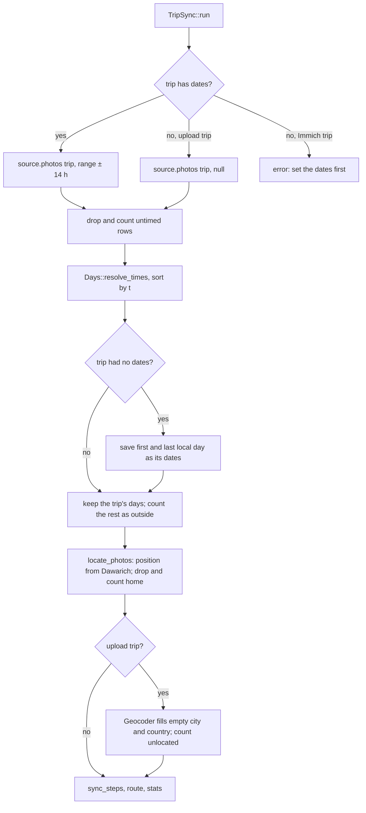

# Trips with photos uploaded to WordPress

Issue: #6 (part of #1). Builds on #4 (private trip uploads), #5 (metadata and the
photo proxy for uploads) and #17 (per-user keys, author-only sync).

## Goal

A trip can take its photos from uploads to that trip instead of from Immich. The
author picks the source on the trip page, uploads through the WordPress media
modal, and sync turns the uploads into steps as it does Immich favourites.

Success:

- A trip with uploaded photos across three days syncs into three steps, with
  places named by the offline geocoder, every photo shown, and pin, hide and
  cover working.
- A trip without dates takes them from its uploads, so create, upload and sync
  works without typing a date.
- The sync notice counts uploads it left out or couldn't map.
- Immich trips behave exactly as before; their smoke checks pass unchanged.
- It works end to end on a phone and a desktop browser.

Out of scope: mixing Immich and uploads in one trip; picking existing Media
Library images; setting the time of undated uploads; removing GPS from
originals; an admin notice for a copy the proxy refused because it found GPS; a
`travel_steps_photo_source` filter.

## Decisions

| Question | Decision |
|---|---|
| Sync after uploading | Closing the modal syncs, if anything was added or deleted. |
| HEIC on WordPress 6.5–6.6 | Require WordPress 6.7, which converts HEIC. |
| Uploads taken at home | Dropped, as Immich photos are, and counted in the notice. |
| Delivery | Two PRs: sync and data first, then the trip page and docs. |
| Where shared sync work happens | In `TripSync`, for every source: sources return raw rows. |
| Geocoding | Upload trips only, so Immich trips don't change. |

## PR 1: sync and data

### Data flow

### `PhotoSource`

`photos( int $trip_id, ?array $range )`, where `$range` is `[start, end]` in
unix time or null when the trip has no dates.

Rows keep the fields documented today, except that sources no longer resolve
times. Each row carries:

- `local`: the wall-clock time it was taken, as a unix time read as UTC, or
  null if the photo has no capture time;
- `zoned`: whether `t` is exact (the photo recorded its offset).

`t` is exact when `zoned` is true; otherwise it equals `local`, and
`resolve_times()` replaces it. `TripSync` drops rows whose `local` is null,
then calls `Days::resolve_times()` and sorts by `t`, for every source.
`ImmichClient::photos()` stops calling `resolve_times()` and sorting.
Immich's results don't change: the same function runs over the same rows.

`image()` stays. The proxy serves uploads before it asks the source.

### `ImmichSource`

Album mode ignores the range. Date mode returns the existing "Set the trip
start and end dates first." error when the range is null, so an Immich trip
without dates fails as it does today.

### `MediaSource`

New. One row per upload on the trip (attachments with `_ts_photo_id` and
`post_parent` = trip, any status):

| Field | From |
|---|---|
| `id` | `_ts_photo_id` |
| `local` | `_ts_exif.taken` as UTC, or null if empty |
| `zoned`, `t` | `_ts_exif.offset`: when set, `zoned` and `t` = `local` − offset; else `t` = `local` |
| `day` | the date part of `_ts_exif.taken`, or empty |
| `lat`, `lon` | `_ts_exif` |
| `w`, `h` | the attachment metadata (the size as displayed) |
| `camera` | `_ts_exif.camera` |
| `city`, `country`, `caption` | empty |
| `fav` | true |

It ignores the range: the uploads are the trip's own photos, like an album.
`image()` returns a `WP_Error`.

### Choosing the source

- New trip meta `_ts_source` (`Trips::META_SOURCE`): `uploads` or `immich`.
  Empty means `immich`, so existing trips don't change.
- `Trips::source()` returns `MediaSource` for `uploads`, else
  `ImmichSource( ImmichClient::for_user( author ) )` as now.
- `Trips::uses_uploads( $trip_id )` answers the question for templates and
  sync.
- `handle_save_trip()` accepts `source` from the author only, like dates and
  album: a non-author's request containing it gets the 403 from #17.

### `TripSync`

- With no dates: an upload trip goes ahead with a null range. After resolving
  times, sync saves the first and last local day of the timed uploads as
  `_ts_start` and `_ts_end`. With no timed uploads it returns "None of the
  trip's photos say when they were taken, so set its dates." An Immich trip
  fails as before.
- With dates: the range keeps its 14-hour margin, as now.
- After `locate_photos()`, for upload trips only, one `Geocoder` fills an empty
  `city` and `country` for every photo with a position.
- For upload trips the result gains
  `left_out => [ outside, untimed, home ]` and `unlocated`: photos still shown
  but with no position, from neither GPS nor Dawarich. `run_sync_and_redirect()`
  passes these to the edit page in the query string, as it does `new_steps`.
- `locate_photos()` keeps uploads without a camera, because every upload is a
  favourite.

### Hardening

- Trip uploads must be images: the prefilter refuses any other type for a
  flagged upload. `Exif::imagick()` would otherwise open a PDF or a video.
- `Requires at least: 6.7` in the plugin header and readme.txt.
- `rest_prepare_attachment` removes `source_url`, `media_details` and `link`
  for trip photos, as `Uploads::prepare_for_js()` does for the modal. Confirm
  first that core REST returns them to editors.
- The proxy's ETag for an upload includes its `_ts_version` attachment meta,
  which `Uploads::new_copies()` sets to the current time, so an edited upload
  doesn't keep its old image in browsers that revalidate. Immich photos keep
  today's ETag.
- `Geocoder::available()` reports whether the data files exist. Sync of an
  upload trip passes `no_places=1` when they don't.

### Tests (smoke, `make check`)

- Fixture JPEGs (`ts_tagged_jpeg()`) on three days, with GPS near three
  towns: three steps, places named by the geocoder, every photo in
  `photos_by_step()` shown, and pin, hide and cover through the REST routes.
- A trip without dates gets them from its uploads; one with only untimed
  uploads gets the error.
- Counts: one upload outside the dates, one untimed, one at home, one with no
  GPS and no Dawarich.
- An upload without a camera is kept.
- An Immich trip without dates still fails; all existing Immich checks pass
  unchanged.
- A non-author can't change the source.
- A flagged non-image upload is refused.
- `/wp/v2/media/<id>` as an editor has no file URL or name for a trip photo.
- The ETag changes when a photo's copies change.

## PR 2: the trip page, the modal and docs

### The "Photos" select

Shown to the author only, as the album select is now. One select:

- "Photos uploaded to this trip";
- "All Immich photos taken during the trip";
- each Immich album, as now.

Rules:

- The Immich options appear only when the site has an Immich URL and the
  author has a key; otherwise a line says "Add an Immich key in settings to use
  Immich photos."
- Without `exif`, the uploads option is disabled, with the reason beside it.
- With neither, the select is replaced by a line saying what the site needs.
- A new trip defaults to uploads when its author can't use Immich, otherwise to
  "All Immich photos", today's default.
- With uploads chosen, the date fields aren't `required`, and a hint says
  "Leave empty to take them from the photos."

### Adding photos

- An upload trip's edit page has a "Photos" panel with the number of uploads
  and an **Add photos** button.
- On a new trip, choosing uploads relabels Save as **Save and add photos**. It
  redirects to the edit page with `?add=1`, which opens the modal on load.
- The modal is `wp.media` with
  `library: { uploadedTo: trip, travel_steps_photo: 1, type: 'image' }`,
  uploader params `post_id` = trip and `travel_steps_photo=1`, and a "Done"
  button. Deleting uses core's "Delete permanently".
- The page records any upload or deletion. If there was one, closing the modal
  submits the existing sync form, and the page reloads with the sync notice.
- A non-author editor can add photos (as #4 allows) but not sync. Closing the
  modal reloads with "Photos added. %s needs to sync the trip."
- **First task:** check that `wp_enqueue_media()` and its footer templates work
  on wp-app pages, since `wp_app_head()` dequeues theme assets. If they don't,
  stop and ask before working around it.

### Sync notice for upload trips

After "Synced. %d new draft steps.", only for counts above zero:

- "Left out: %d outside the trip's dates, %d with no time taken (often sent
  through a messaging app, or a screenshot), %d taken at home."
- "%d photos have no location, so they aren't on the map. iPhone browsers drop
  it unless you turn on Options → Location before uploading; messaging apps
  strip it."
- "Place names are unavailable: the plugin's geonames data is missing."

### Wording by source

| Where | Immich trip (unchanged) | Upload trip |
|---|---|---|
| Heart on photos (`trip.php`) | "Favourite in Immich" | none: every upload is a favourite |
| Photos block, empty | "…Favourite some in Immich and sync." | "…Add photos to the trip." |
| Steps panel, empty | "Favourite photos in Immich and sync…" | "Add photos and sync: each day with photos gets a step." |
| Sync panel, never synced | as now | "Syncing makes a draft step for each day with photos, named after where they were taken." |
| Missing Immich key warning | shown | not shown |
| "No favourites" warning | shown | not shown |
| Photo limit paragraph | shown | not shown |

### Settings

- The Immich fieldset becomes "Immich (optional)".
- With neither an Immich URL nor `exif`, a notice says trips need one of them.
- The site "Photos" text adds: "For a trip with uploaded photos, every upload is
  shown; hide the ones you don't want."

### Docs

README and readme.txt: Immich is optional; uploads, their private storage and
deletion with the trip; the `exif` extension and WordPress 6.7 requirements;
an uploads path in the setup steps.

### Testing

- Smoke: the select's options for each account state; `required` on the dates;
  the `?add=1` page; owner and non-owner views; the wording table.
- Browser, on `make demo`: upload, thumbnails through the proxy, delete, and
  sync on close.
- Docker (`wordpress:php8.3-apache`), before merge: a direct file URL under
  `uploads/travel-steps/` gives 403; the REST fix against a real
  `/wp/v2/media` response.
- On selfhoster, by the user: phone and desktop end to end, and the checks
  carried over from #5 (`_ts_exif` against `exiftool` for real HEIC and JPEG,
  no GPS in any served size, private before publishing, 404 signed out).
